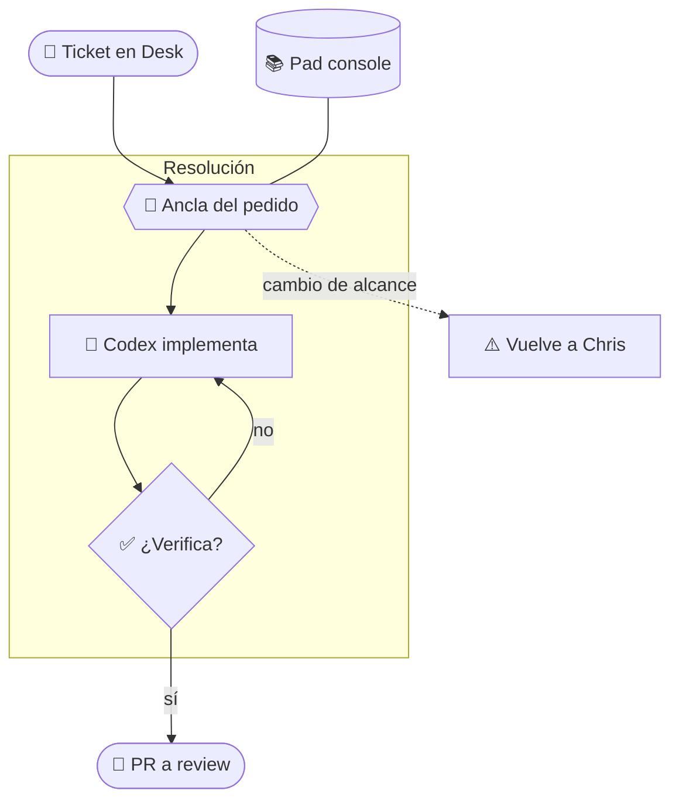
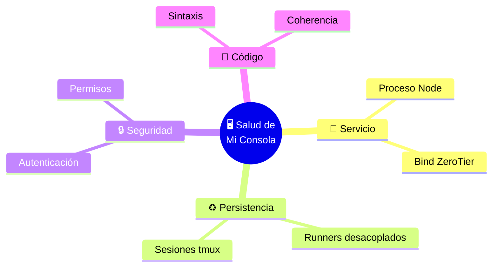
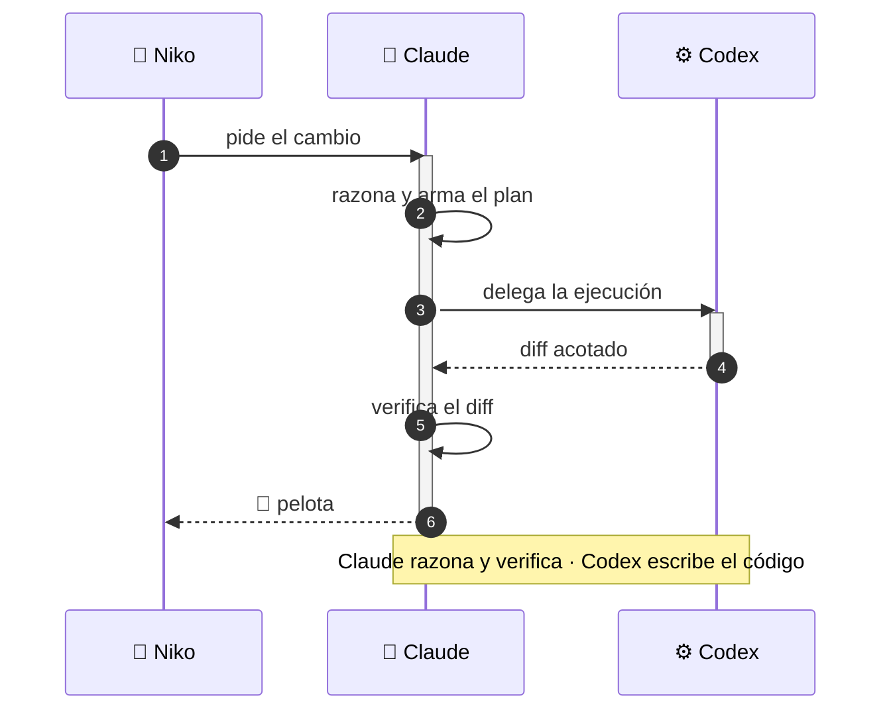

# 📊 Graficar datos en la consola

Elegí la forma más informativa y ubicala dentro del relato. No agregues una visualización si
el texto comunica mejor el dato.

## Regla de decisión

| Naturaleza del dato | Forma | Sintaxis |
|---|---|---|
| Partes de un todo (suman 100%), 2-6 categorías | dona | ```` ```chart ```` con `type: "doughnut"` |
| Comparar magnitudes entre categorías | barras (`bar`; `hbar` si las etiquetas son largas) | ```` ```chart ```` |
| Evolución en el tiempo | línea | ```` ```chart ```` con `type: "line"` |
| Estructura, jerarquía, flujo, mapa mental | Mermaid (`flowchart`, `mindmap`) | ```` ```mermaid ```` + clases `:::rol` |
| Secuencia de pasos entre actores | Mermaid `sequenceDiagram` | ```` ```mermaid ```` + clases `:::rol` |
| Un dato suelto dentro de un cuadro | micro-barra | `{bar:62}` sola en la celda |
| 1 o 2 números sin comparación | NO graficar — texto o tabla | — |

Para `chart`, escribir JSON con `type`, `labels` y `data`. Admitir hasta 24 etiquetas y hasta
4 series `{label, data:[]}` en barras o líneas. Usar `title` para decir qué se mide, `unit`
para una unidad de hasta 8 caracteres y `stacked: true` solo en `bar` o `hbar`.

## 🎨 Mermaid con diseño

La consola inyecta una **paleta semántica** en cada diagrama: no hace falta escribir `style`
ni ningún color a mano. Se aplica con `:::clase` al final del nodo, **solo en `flowchart` y
`graph`**. Va **SIN espacio**: `A[texto]:::ok` es válido y `A[texto]::: ok` rompe el
diagrama entero con `Parse error ... Expecting 'AMP', 'COLON'` (caso real medido en
producción el 2026-07-30). En `mindmap` la sintaxis `:::` no existe y se dibujaría como
texto literal dentro del nodo (`Permisos:::warn`). El mindmap no la necesita: **cada rama
toma un color distinto sola**, y la raíz va siempre en el acento de la casa.

| Clase | Cuándo usarla | Se ve |
|---|---|---|
| `:::key` | el nodo protagonista del diagrama | terracota (acento de la casa) |
| `:::ok` | resuelto, sano, camino feliz | verde |
| `:::warn` | atención, pendiente, degradado | ámbar |
| `:::bad` | error, bloqueo, riesgo | rojo |
| `:::info` | en revisión, esperando a un tercero | azul apagado |
| `:::cool` | actor externo o sistema de terceros | azul frío |
| `:::deep` | IA, motor, proceso automático | violeta |
| `:::muted` | contexto secundario, fuera de foco | gris tenue |

Un nodo **sin clase** queda con el estilo por defecto: eso también es una decisión, sirve
para lo neutro. Si todo lleva color, nada resalta.

En `sequenceDiagram` tampoco hay clases: ahí el color lo ponen los propios elementos del
diagrama —actores, activaciones y `Note`— que ya vienen tematizados.

### Las seis reglas de composición

1. **Agrupar en `subgraph`.** Un diagrama sin secciones es una lista con flechas. Los
   `subgraph` se dibujan como secciones tituladas y son lo que da *estructura*.
2. **Variar la forma según la naturaleza del nodo**, nunca por decorar:

   | Forma | Sintaxis | Significa |
   |---|---|---|
   | rectángulo | `A[Texto]` | proceso o paso |
   | rombo | `A{Texto}` | decisión |
   | cilindro | `A[(Texto)]` | dato persistido |
   | estadio | `A([Texto])` | inicio, fin o evento |
   | hexágono | `A{{Texto}}` | punto de control o gate |
   | paralelogramo | `A[/Texto/]` | entrada o salida humana |

3. **Etiquetar las aristas** con la condición o el verbo — `A -->|si falla| B` —; se dibujan
   como píldora y convierten el diagrama en una frase legible.
4. **Un emoji al principio de la etiqueta** como ancla visual (🖥️ 🌳 ⚠️ ✅ 📨 🤖). Uno por
   nodo, nunca dos.
5. **Segunda línea con `<br/>`** para el detalle: el qué arriba, el dato fino debajo.
6. **El ancho es el recurso escaso.** En el chat entran cómodos unos tres niveles en
   horizontal; pasado eso el diagrama se corta y hay que deslizarlo. Si el flujo tiene más
   pasos, usar `flowchart TD` en vez de `LR`: crece hacia abajo, que es donde sobra espacio.

Tope práctico: **unos 14 nodos**. Si no entra, partirlo en dos diagramas — uno ilegible no
comunica más por tener todo adentro.

## Los cuatro NO

1. **NO graficar 1-2 valores:** un gráfico de 2 barras dice menos que la frase.
2. **NO duplicar:** si el gráfico ya lo cuenta, la tabla con los mismos números al lado
   sobra. El gráfico ya lleva su fuente plegada en **Ver datos del gráfico**.
3. **NO usar más de 2 gráficos por respuesta**, salvo que el usuario pida un tablero.
4. **NO inventar datos para llenar un gráfico:** si el número no se midió, escribir
   “no medido”; nunca convertirlo en una porción de la dona.

## Integrarlo a la narración

Colocar el gráfico **inmediatamente después** de la frase que lo introduce. Interpretarlo en
la frase siguiente: “lo que salta acá es…”. No dejarlo suelto ni moverlo al final como anexo.
El `title` dice **qué se mide**; la prosa dice **qué significa**.

Al usar el formato Relato Anclado, mantener las anclas 🔴🟠🟡🟢🔵🟣 en el mismo orden que
las categorías de `labels`. La paleta es estable y cicla así: acento terracota → azul frío →
ámbar → verde → violeta → info → rojo → naranja.

## Ejemplos copiables

### Dona · hallazgos por severidad

Los hallazgos de menor severidad concentran la mayor parte de la revisión:

```chart
{
  "type": "doughnut",
  "title": "Hallazgos por severidad",
  "labels": ["Crítico", "Alto", "Medio", "Bajo"],
  "data": [3, 11, 24, 62],
  "unit": "%"
}
```

Lo que salta acá es que el 86% está entre severidad media y baja, aunque el 3% crítico exige
atención inmediata.

### Barras multi-serie · consumo de tokens

El consumo semanal permite comparar el trabajo de ambos motores:

```chart
{
  "type": "bar",
  "title": "Consumo de tokens por semana",
  "labels": ["Semana 1", "Semana 2", "Semana 3", "Semana 4"],
  "data": [
    { "label": "Claude", "data": [84000, 91000, 76000, 103000] },
    { "label": "Codex", "data": [51000, 63000, 58000, 71000] }
  ],
  "unit": "tokens"
}
```

Lo que salta acá es el pico conjunto de la semana 4, no una sustitución de un motor por otro.

### Línea · evolución de tickets

La resolución de tickets muestra una aceleración sostenida:

```chart
{
  "type": "line",
  "title": "Tickets resueltos por semana",
  "labels": ["1 jul", "8 jul", "15 jul", "22 jul"],
  "data": [8, 11, 15, 19],
  "unit": "tickets"
}
```

Lo que salta acá es que el ritmo más que se duplicó entre la primera y la cuarta semana.

### Mermaid · flujo con secciones y paleta

El ciclo de un ticket se lee mejor separando entrada, resolución y salida:



Lo que salta acá es que la verificación es un lazo, no un paso: el diagrama muestra que
volver a Codex es lo normal, y que el único camino a Chris es el desvío de alcance.

### Mermaid · mapa mental con anclas

La salud de la consola se organiza en cuatro frentes de naturaleza distinta:



Lo que salta acá es que la salud no es solo disponibilidad: la persistencia y la coherencia
del código pesan igual que el proceso vivo. Cada rama se distingue por su color sin que el
diagrama lo pida.

### Mermaid · secuencia entre actores

El modo Tándem reparte el trabajo entre dos motores distintos:



Lo que salta acá es que Claude nunca deja de tener la posta: delega la escritura, pero la
verificación vuelve a él antes de llegar a Niko.

### Tabla · micro-barra de estado

| Estado de tickets | Proporción |
|---|---|
| Resueltos | {bar:62} |
| En curso | {bar:27} |
| Bloqueados | {bar:11} |

## Límites y degradación

- Usar como máximo 6 gráficos por mensaje.
- Si el JSON es inválido, el bloque cae a código fuente visible con un aviso.
- Mermaid no renderiza diagramas de más de 400 líneas.
- Los gráficos se dibujan en el navegador del usuario: no cuestan tokens de render. Solo
  cuesta el JSON escrito en la respuesta.
- Las clases `:::rol` solo pintan en la consola y solo en `flowchart`/`graph`: fuera de ella
  el diagrama sigue siendo válido, pero se ve con los colores por defecto de Mermaid.
- Si una clase no existe, Mermaid ignora el `:::` sin romper el diagrama.
- Una clase que NO EXISTE se ignora sin consecuencias; un ESPACIO después de `:::`, en
  cambio, es error de SINTAXIS y no se dibuja nada.

## Dónde funciona

Funciona en el chat de la consola y en cualquier superficie que use `renderMarkdown`, como
Aprendizaje y Pendientes. No funciona en artefactos que salen de la consola —correos, PRs,
comentarios de Pad o comunicación al mundo externo—; allí usar texto o una tabla plana.
