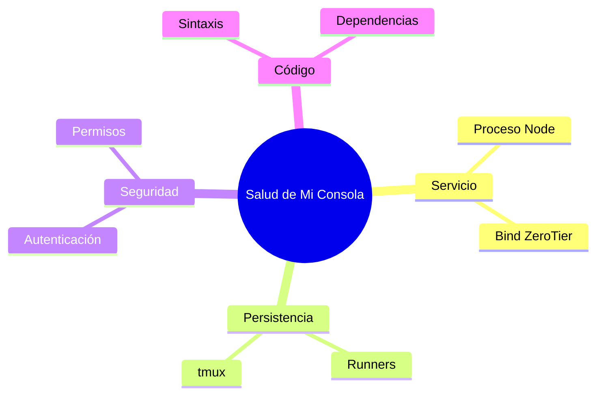

# 📊 Graficar datos en la consola

Elegí la forma más informativa y ubicala dentro del relato. No agregues una visualización si
el texto comunica mejor el dato.

## Regla de decisión

| Naturaleza del dato | Forma | Sintaxis |
|---|---|---|
| Partes de un todo (suman 100%), 2-6 categorías | dona | ```` ```chart ```` con `type: "doughnut"` |
| Comparar magnitudes entre categorías | barras (`bar`; `hbar` si las etiquetas son largas) | ```` ```chart ```` |
| Evolución en el tiempo | línea | ```` ```chart ```` con `type: "line"` |
| Estructura, jerarquía, flujo, mapa mental | Mermaid (`flowchart`, `mindmap`) | ```` ```mermaid ```` |
| Secuencia de pasos entre actores | Mermaid `sequenceDiagram` | ```` ```mermaid ```` |
| Un dato suelto dentro de un cuadro | micro-barra | `{bar:62}` sola en la celda |
| 1 o 2 números sin comparación | NO graficar — texto o tabla | — |

Para `chart`, escribir JSON con `type`, `labels` y `data`. Admitir hasta 24 etiquetas y hasta
4 series `{label, data:[]}` en barras o líneas. Usar `title` para decir qué se mide, `unit`
para una unidad de hasta 8 caracteres y `stacked: true` solo en `bar` o `hbar`.

## Los cuatro NO

1. **NO graficar 1-2 valores:** un gráfico de 2 barras dice menos que la frase.
2. **NO duplicar:** si el gráfico ya lo cuenta, la tabla con los mismos números al lado
   sobra. El gráfico ya lleva su fuente plegada en **Ver datos del gráfico**.
3. **NO usar más de 2 gráficos por respuesta**, salvo que el usuario pida un tablero.
4. **NO inventar datos para llenar un gráfico:** si el número no se midió, escribir
   “no medido”; nunca convertirlo en una porción de la dona.

## Integrarlo a la narración

Colocar el gráfico **inmediatamente después** de la frase que lo introduce. Interpretarlo en
la frase siguiente: “lo que salta acá es…”. No dejarlo suelto ni moverlo al final como anexo.
El `title` dice **qué se mide**; la prosa dice **qué significa**.

Al usar el formato Relato Anclado, mantener las anclas 🔴🟠🟡🟢🔵🟣 en el mismo orden que
las categorías de `labels`. La paleta es estable y cicla así: acento terracota → azul frío →
ámbar → verde → violeta → info → rojo → naranja.

## Ejemplos copiables

### Dona · hallazgos por severidad

Los hallazgos de menor severidad concentran la mayor parte de la revisión:

```chart
{
  "type": "doughnut",
  "title": "Hallazgos por severidad",
  "labels": ["Crítico", "Alto", "Medio", "Bajo"],
  "data": [3, 11, 24, 62],
  "unit": "%"
}
```

Lo que salta acá es que el 86% está entre severidad media y baja, aunque el 3% crítico exige
atención inmediata.

### Barras multi-serie · consumo de tokens

El consumo semanal permite comparar el trabajo de ambos motores:

```chart
{
  "type": "bar",
  "title": "Consumo de tokens por semana",
  "labels": ["Semana 1", "Semana 2", "Semana 3", "Semana 4"],
  "data": [
    { "label": "Claude", "data": [84000, 91000, 76000, 103000] },
    { "label": "Codex", "data": [51000, 63000, 58000, 71000] }
  ],
  "unit": "tokens"
}
```

Lo que salta acá es el pico conjunto de la semana 4, no una sustitución de un motor por otro.

### Línea · evolución de tickets

La resolución de tickets muestra una aceleración sostenida:

```chart
{
  "type": "line",
  "title": "Tickets resueltos por semana",
  "labels": ["1 jul", "8 jul", "15 jul", "22 jul"],
  "data": [8, 11, 15, 19],
  "unit": "tickets"
}
```

Lo que salta acá es que el ritmo más que se duplicó entre la primera y la cuarta semana.

### Mermaid · mapa mental de salud

La revisión de salud se organiza en cuatro frentes:



Lo que salta acá es que la salud no es solo disponibilidad: también incluye persistencia,
seguridad y coherencia del código.

### Tabla · micro-barra de estado

| Estado de tickets | Proporción |
|---|---|
| Resueltos | {bar:62} |
| En curso | {bar:27} |
| Bloqueados | {bar:11} |

## Límites y degradación

- Usar como máximo 6 gráficos por mensaje.
- Si el JSON es inválido, el bloque cae a código fuente visible con un aviso.
- Mermaid no renderiza diagramas de más de 400 líneas.
- Los gráficos se dibujan en el navegador del usuario: no cuestan tokens de render. Solo
  cuesta el JSON escrito en la respuesta.

## Dónde funciona

Funciona en el chat de la consola y en cualquier superficie que use `renderMarkdown`, como
Aprendizaje y Pendientes. No funciona en artefactos que salen de la consola —correos, PRs,
comentarios de Pad o comunicación al mundo externo—; allí usar texto o una tabla plana.
